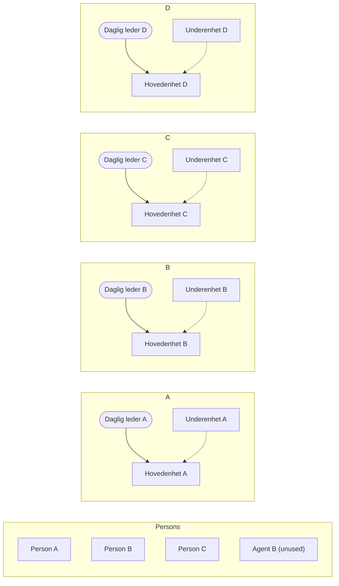
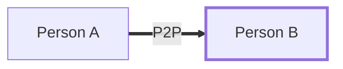
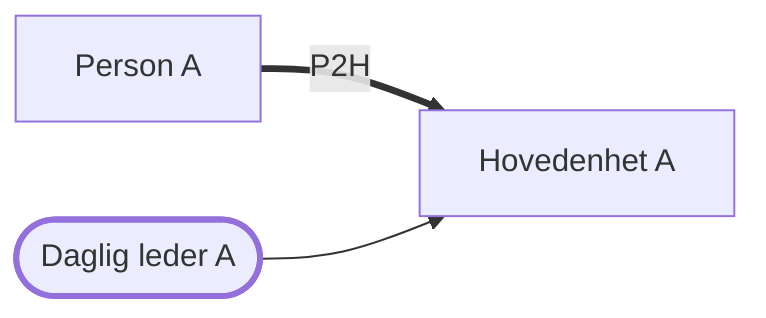
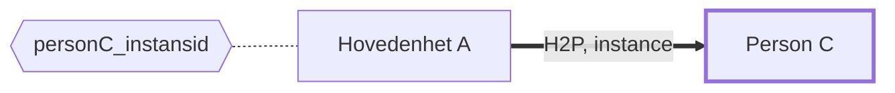
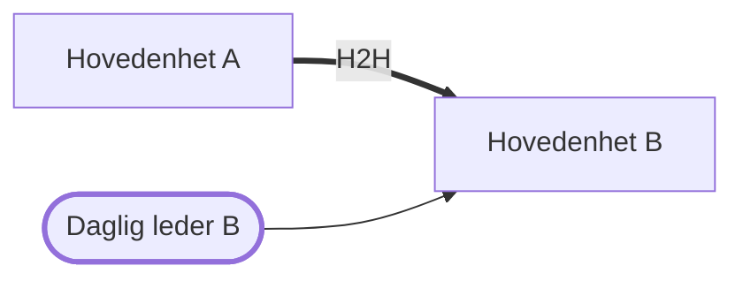
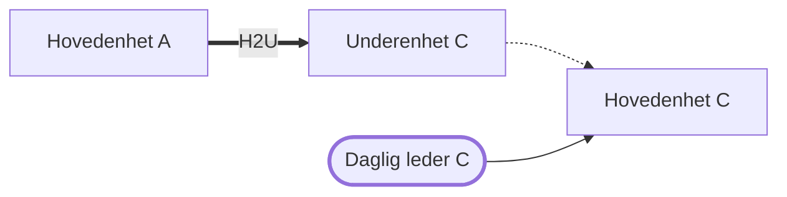
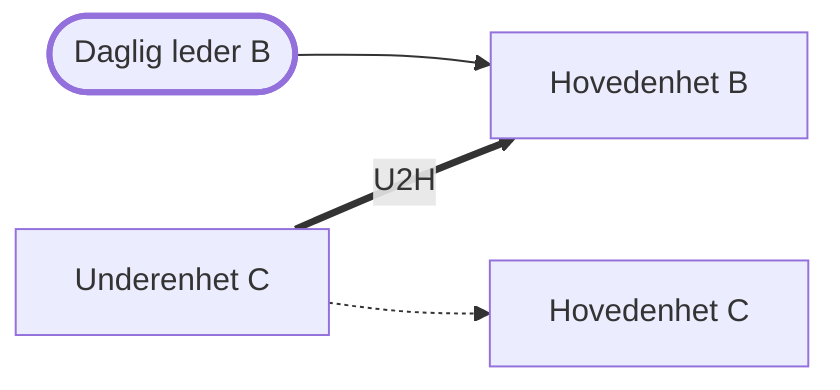
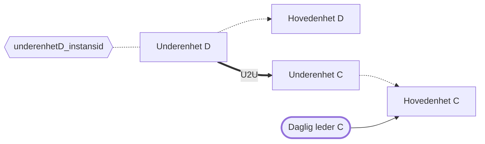
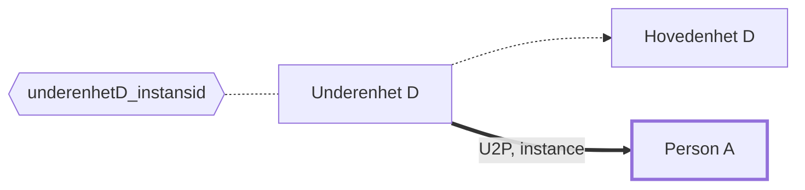

# Authorized parties as end user

Ported from the Bruno suite at
[AsEndUser_authParties](https://github.com/Altinn/altinn-authorization-tmp/tree/main/src/apps/Altinn.AccessManagement/test/Bruno/AccessMgmt/test/auth_parties_Hovedenhet_Underenhet/AsEndUser_authParties).

Each test authenticates as the recipient of a delegation and asserts that the delegating
party shows up in the authorized parties list with exactly the access the query asks for.
The parties themselves live in `testdata-<environment>.json`, while the delegated access
packages, resources and instances are hardcoded in the test files.

The test name in the table below is the k6 group label the scenario reports under, which
is what shows up in the summary output and in the Slack message.

| Test | Delegation | Authenticates as | Query |
| --- | --- | --- | --- |
| `Person-B-får-person-A-i-aktørlista` | Person A to person B (P2P) | Person B | `includeRoles=false`, `includeAccessPackages=true` |
| `dagl-A-får-person-A-i-aktørlista` | Person A to hovedenhet A (P2H) | Daglig leder of hovedenhet A | `includeResources=true` |
| `Person-C-får-hovedenhet-A-i-aktørlista` | Hovedenhet A to person C (H2P) | Person C | `includeInstances=true` |
| `dagl-B-får-hovedenhet-A-i-aktørlista` | Hovedenhet A to hovedenhet B (H2H) | Daglig leder of hovedenhet B | `includePartiesViaKeyRoles=true` |
| `dagl-av-underenhet-får-hovedenhet-A-i-aktørlista` | Hovedenhet A to underenhet C (H2U) | Daglig leder of hovedenhet C | `anyOfResourceIds`, `partyFilter` |
| `dagl-B-får-underenhet-C-i-aktørlista` | Underenhet C to hovedenhet B (U2H) | Daglig leder of hovedenhet B | `includeRoles`, `includeAccessPackages`, `includeResources` |
| `dagl-C-får-underenhet-D-i-aktørlista` | Underenhet D to underenhet C (U2U) | Daglig leder of hovedenhet C | all four include filters |
| `Person-A-får-underenhet-D-i-aktørlista` | Underenhet D to person A (U2P) | Person A | `partyFilter`, `includeInstances=true` |

The file names are the group labels transliterated, so `å` becomes `aa` and `ø` becomes
`oe`. `dagl-av-underenhet-får-hovedenhet-A` and `dagl-C-får-underenhet-D` are skipped by a
`skipDueToKnownBug` flag, matching the Bruno suite. Flip the flag once the bug is fixed.

## Test data

The parties in `testdata-<environment>.json`. A thin arrow points from a daglig leder to
their hovedenhet, and a dotted arrow from an underenhet to its hovedenhet. Person C is
nested under hovedenhet A in the file, but the only link between them is the H2P
delegation below. Agent B is in the file, but no test uses it.



## Scenarios

One graph per test, with only the parties that test needs. A thick arrow is the delegation,
which is not in the test data file and has to exist in the environment before the test
runs. The user the test logs in as has a thick border. A hexagon is an instance from
`instancer`, joined to the party that owns it (the party ID at the start of the instance
URN). `personA_instansid` and `hovedenhetA_instansid` are in the file, but no test uses
them.

### `Person-B-får-person-A-i-aktørlista`



### `dagl-A-får-person-A-i-aktørlista`



### `Person-C-får-hovedenhet-A-i-aktørlista`



### `dagl-B-får-hovedenhet-A-i-aktørlista`

Daglig leder B sees hovedenhet A through the key role on hovedenhet B
(`includePartiesViaKeyRoles=true`).



### `dagl-av-underenhet-får-hovedenhet-A-i-aktørlista`

Skipped by `skipDueToKnownBug`.



### `dagl-B-får-underenhet-C-i-aktørlista`



### `dagl-C-får-underenhet-D-i-aktørlista`

Skipped by `skipDueToKnownBug`.



### `Person-A-får-underenhet-D-i-aktørlista`



## Running

```
k6 run K6/api/tests/access-management/enduser/person-b-faar-person-a-i-aktoerlista.js
```

`ENVIRONMENT` and `BASE_URL` are required. `ENVIRONMENT` also picks the test data file, so
it has to match one of the `testdata-<environment>.json` files.
